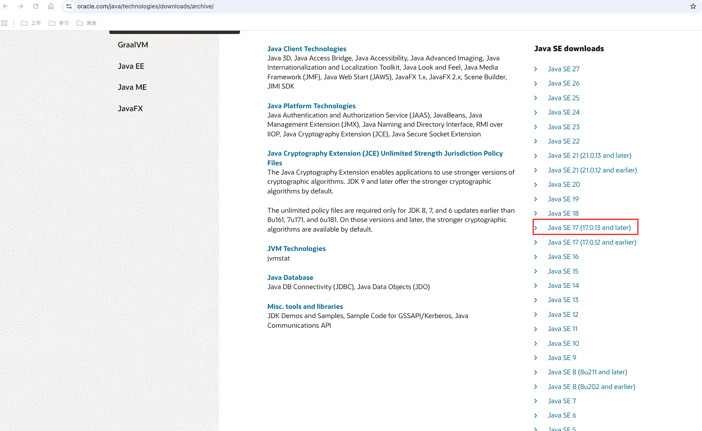
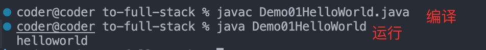
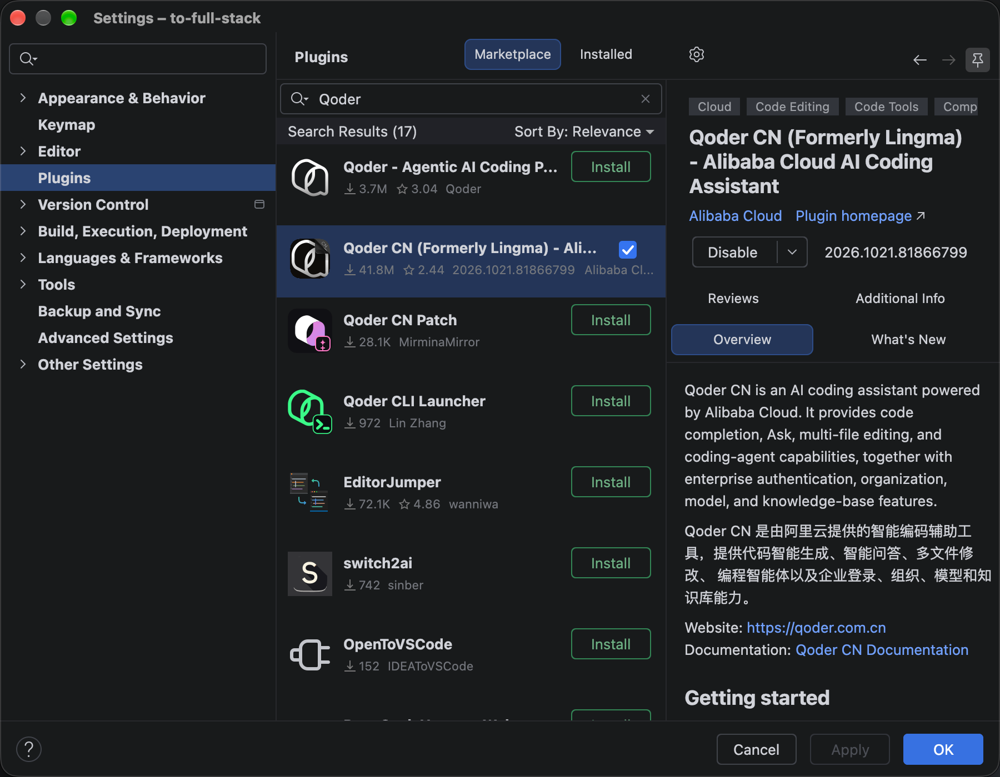

# Day 01｜Hello, Java：从 JDK 到第一个 HelloWorld

## Java语言介绍

### Java 是什么？

Java名字来源：印尼爪哇岛（Java），当地盛产咖啡，所以用这个名字，也是 Java 经典咖啡图标的由来。

Java 是一门**面向对象**、**强类型**的编程语言，也是目前国内后端开发里最主流的语言。
和我们前端天天写的 JavaScript 不一样，Java 是强类型语言，定义变量的时候就要明确它是什么类型，约束更严格，好处是大型项目更容易维护，不容易出现隐性类型 bug。

> 很多前端伙伴会联想到 TypeScript，这里顺便说一下：二者确实有相似之处，都依靠类型约束，提前拦截类型相关的错误。但底层差别不小：TS 只是给 JS 增加的一层类型注解，最后依然会编译成 JS 运行，类型可以选择关闭，还能写 any 绕过校验；而 Java 从语言设计之初就自带强类型，类型是硬性要求，没有简单关掉类型检查的办法，规则会更硬核。

它最出名的特点就是 **一次编写，到处运行** 。Java 源代码（`.java`）编译之后，会生成 `.class` 文件，文件里面存放的就是字节码。同一份字节码不用改动，在不同系统上，安装**对应平台版本的 JVM**就可以运行。后端服务器大多是 Linux 环境，这也是 Java 在企业服务里大火的重要原因。

### Java 分成三大分支：

1. **JavaSE（Java 标准版）**：就是语言本身，也是我第一周要啃的内容，包含基础语法、面向对象、集合、IO、多线程等，是所有 Java 开发的地基。
2. **JavaEE（企业版，现名 Jakarta EE）**：是一套 Web 开发规范，Servlet、JavaWeb 都属于这部分，用来做 web 服务。
3. **JavaME（微型版）**：早年用于手机、嵌入式设备，现在基本很少使用。

平时大家口中说的 Spring、SpringBoot、MyBatis 这些，**并不是 Java 语言本身**，而是基于 JavaSE 开发出来的框架，就像前端的 Vue、React，帮我们省去大量重复的底层代码，企业开发基本都基于 SpringBoot 来写业务接口、对接数据库。

Java 生态非常成熟，MySQL、Redis、MQ、Nginx 这些中间件，对 Java 的适配都很好，岗位基数大，适合长期做后端业务开发。
对我这种写了六年 JS 的前端来说，最大的适应难点，就是从 JS 松散灵活的写法，切换到 Java 严谨、规范、强类型的编码模式。

### JDK 和 JRE

- JDK(Java Development Kit):java开发工具包,里面包含了JRE,以及一些开发工具
- JRE(Java Runtime Environment):java运行的环境,JRE包含JVM以及核心类库

### JDK版本介绍

JDK现在发布的节奏：

1. 每 6 个月一个正式版（3 月、9 月）
2. 每 2 年的 9 月版本定为长期支持版（11、17、21、25……）
3. 截止今天 2026.11.03，最新的的正式版是 27（2026-09）、最新的长期支持版是25（2025-09）

一般新版本出来在企业中不会这么快使用，因为可能会有很多 Bug，生成还是更需要稳定，我们公司就还在用 1.8的版本...这次我计划使用 17 的版本用来学习。

#### JDK的安装

`1.进入oracle官网下载 -> https://www.oracle.com/java/technologies/downloads/archive/`



2. 找到自己对应的版本下载
3. `双击-> 一路下一步`
4. `注意-> 安装的过程中 -> 选择一下安装路径 -> 开发相关的软件安装路径上都不要有中文,空格`
5. 测试：进入到jdk的bin目录下 ->打开对应路径的命令窗口 ->使用两个命令: javac:编译命令 、java: 运行命令
6. 配置环境变量

这部分网上资源很多，可以直接看 [菜鸟教程](https://www.runoob.com/java/java-environment-setup.html)

## Java第一个程序的开发

### 开发三步骤

```java
1.编写
  a.在vscode 创建一个 Demo1HelloWorld.java 的文件
    (这个时候vscode可能会提示装java相关插件，我们都给装上)
  b.在 HelloWolrd中编写代码（先不用管内容）
    public class Demo01HelloWorld{
		public static void main(String[] args){
			System.out.println("helloworld");
		}
	}
  c.编译:javac  -> 生成一个xxx.class文件(字节码文件) -> jvm运行java程序只认class文件
  	javac Demo01HelloWorld.java
  d.运行:java
  	java Demo01HelloWorld.class
```

```java

2.编译:javac  -> 生成一个xxx.class文件(字节码文件) -> jvm运行java程序只认class文件
  javac java文件名.java
3.运行:java
  java class文件名
```



> 在 `Demo01HelloWorld.java`，我们就是输出了一个`helloworld`字符串

## IDEA

上面用了 VSCode，但其实`java最常用的还是最重要的开发工具` 还是 `IDEA`

我是直接去某鱼上买了全家桶，IDEA可以使用到 2099 年

一些建议：

1. 不要汉化还是使用英文版的
2. 可以装一个 AI插件 Qoder，在 Settings ->Plugins 搜索 Qoder->登录自己的账号

   

3. 还有一些快捷键

| Windows           | Mac                                        | 功能说明                         |
| ----------------- | ------------------------------------------ | -------------------------------- |
| `Alt+Enter`       | `⌥ + ⏎`（Option+Enter）                    | 导入包、自动修正代码（重中之重） |
| `Ctrl+Y`          | `⌘ + ⌫`（Cmd+Backspace）                   | 删除光标所在行                   |
| `Ctrl+D`          | `⌘ + D`（Cmd+D）                           | 复制光标所在行，插入下方         |
| `Ctrl+Alt+L`      | `⌘ + ⌥ + L`（Cmd+Option+L）                | 格式化代码                       |
| `Ctrl+/`          | `⌘ + /`（Cmd+/）                           | 单行注释                         |
| `Ctrl+Shift+/`    | `⌘ + ⌥ + /`（Cmd+Option+/）                | 选中块多行注释，再次按下取消     |
| `Alt+Shift+↑ / ↓` | `⌥ + ⇧ + ↑ / ↓`（Option+Shift + 上下箭头） | 上下移动当前代码行               |

关于 IDEA的使用其实还是需要自己一点一点的探索，多点点。

## 总结

今日学习总结：

1. 了解了Java 语言是什么
2. 什么是 JDK、JRE 他们的区别
3. JDK的版本 环境安装
4. 写了一个 java程序
5. 安装使用 IDEA
