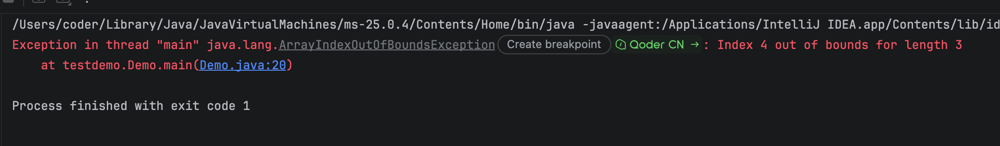

# Day 04｜前端转全栈第 4 天：Java 数组不能 push

## 1. Java中的数组

Java中的数组是 **存储相同类型多个数据的容器** ，属于引用数据类型。
一旦数组创建完成， **长度固定，不可修改** 。

### 1.1 定义格式

和js不同，java中的数组使用大括号表示的 {1,2,3}，并且数组中的类型必须相同

```Java
// 格式1：静态初始化（创建数组的同时直接赋值，自动识别长度）
int[] arr = {11,22,33,44};
// 完整写法
int[] arr2 = new int[]{11,22,33,44};

// 格式2：动态初始化（只指定长度，元素自动赋默认值）
int[] arr3 = new int[5]; // 长度为5，里面初始值都是0
```

注意：不能同时既指定长度，又写大括号赋值

```JavaScript
// 错误写法
int[] arr = new int[5]{1,2,3,4,5};
```

### 1.2 数组元素的默认初始化值

动态初始化后，数组里元素会自动赋值：

- 整数类型（byte、short、int、long）：`0`
- 浮点类型（float、double）：`0.0`
- 布尔类型 boolean：`false`
- 字符类型 char：`'\u0000'`（空字符）
- 引用类型（String、自定义类）：`null`

```Java
double d = new double[2] // {0.0,0.0}
```

### 1.3 访问数组元素

1. 通过下标访问，下标从 `0` 开始
2. 获取数组长度：`数组名.length`（是属性，**没有括号**）

```Java
int[] arr = {10,20,30};
System.out.println(arr[0]); // 取第一个元素
System.out.println(arr.length); // 获取数组长度
```

下标越界：如果下标范围不在 `0 ~ length-1`，运行时抛出 `ArrayIndexOutOfBoundsException` 数组下标越界异常。



### 1.4 数组遍历

1. 普通 for 循环（可以拿到下标，适合需要操作索引的场景）

```Java
int[] arr = {10,20,30,40};
for(int i = 0; i < arr.length; i++){
    System.out.println(arr[i]);
}
```

2. 增强 for 循环（for-each，只拿元素，拿不到下标）

```Java
for(int num : arr){
    System.out.println(num);
}
```

### 1.5 数组是引用类型

数组变量存的是数组在堆内存的**地址值**，不是元素本身。

多个数组变量指向同一个地址时，修改其中一个，另一个也会跟着变化。

```Java
int[] a = {1,2,3};
int[] b = a;
b[0] = 99;
// a[0] 也变成99，二者共用同一块数组
```

### 1.6 Arrays 工具类（java.util.Arrays）

数组本身没有内置方法，大部分操作靠这个工具类，使用前需要导入包

```Java
import java.util.Arrays;

int[] arr = {3,1,5,2};
Arrays.sort(arr);                // 对数组排序（升序）
System.out.println(Arrays.toString(arr)); // 把数组转为字符串打印
int[] newArr = Arrays.copyOf(arr, 10); // 拷贝数组，第二个参数是新数组长度
boolean same = Arrays.equals(arr1,arr2); // 比较两个数组内容是否一致
```

> 重点：直接打印数组变量，输出的是内存地址，看不到里面元素，必须用 `Arrays.toString()`

### 1.7 二维数组

二维数组本质：**数组里面存放一维数组**

```Java
// 静态初始化
int[][] arr = {{1,2},{3,4,5},{6}};
// 动态初始化
int[][] arr2 = new int[3][2]; // 3个一维数组，每个一维数组长度是2
```

遍历二维数组：嵌套循环

```Java
for(int i = 0; i < arr.length; i++){
    for(int j = 0; j < arr[i].length; j++){
        System.out.print(arr[i][j] + " ");
    }
}
```

## 2. Java中的方法

Java 方法属于类成员，是一段可复用代码块；和 JS 函数差异巨大。

### 2.1 方法的定义

```Java
修饰符 返回值类型 方法名(参数列表) {
    // 方法体
    return 返回值;
}
```

示例

```Java
// 公有静态方法
public static int add(int a, int b) {
    return a + b;
}

// 无返回值
public static void sayHello() {
    System.out.println("hello");
    // void 不能 return 数据；可以单独写 return; 提前退出
}
```

### 2.2 修饰符是什么？

像上面的 public static 就是修饰符。

Java 修饰符分两大类： **访问修饰符** 、 **非访问修饰符** 。

#### 2.2.1 访问修饰符

| 修饰符         | 说明                    |
| -------------- | ----------------------- |
| `public`       | 公开，任何地方都能访问  |
| `protected`    | 本类、同包、子类        |
| （默认，不写） | 包访问权限，本类 + 同包 |
| `private`      | 仅本类内部可用          |

`访问权限从大到小：public > protected > 默认 > private`

#### 2.2.2 非访问修饰符

1. static：静态，属于类，不属于实例；静态变量、静态方法、静态代码块
2. final
   - 修饰类：不能被继承
   - 修饰方法：不能重写
   - 修饰变量：常量，只能赋值一次
3. abstract：抽象类 / 抽象方法；抽象方法没有方法体，所在类必须是抽象类
4. 等等...

### 2.3 返回值

Java中方法定义了什么返回值，该方法就要返回什么类型的值

void 的意思是：没有返回值，不返回任何东西，可以单独写 return;

### 2.4 参数

1. Java：每个参数必须标注类型

```Java
public static void printName(String name, int age) {
    System.out.println(name + age);
}
```

调用的时候：实参数量、类型、顺序必须匹配

2. 可变参数，只能放最后，本质是数组

```Java
public static void sum(int... nums) {
    int total = 0;
    for (int n : nums) {
        total += n;
    }
}
```

### 2.5 值传递

- **基本类型：值拷贝**，方法内部修改副本，外部原变量不受影响
- **引用类型：拷贝引用值（地址）**，不是拷贝对象；内部可以修改对象内部属性，但不能让外部引用指向新对

```Java
class Demo {
    public static void change(int x) {
        x = 999;
    }
    public static void main(String[] args) {
        int a = 10;
        change(a);
        System.out.println(a); // 仍然是 10
    }
}
```

### 2.6 方法的重载 Overload

同一个类中：方法名相同，参数列表不同（数量 / 类型 / 顺序），返回值无关。

```Java
public static int add(int a, int b) {
    return a + b;
}
public static double add(double a, double b) {
    return a + b;
}
```

仅仅返回值不一样，不算重载！

> 和JS不同，JS **没有重载** ！同名函数直接覆盖，后面的把前面的冲掉
