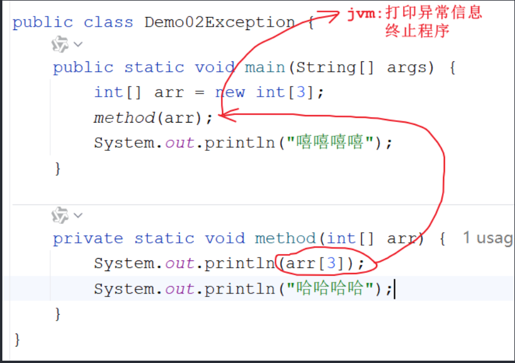

# Day 08｜前端转全栈第 8 天：throw 一个字符串？编译不过

今天这三块内容——枚举、异常、Object 类——在前端看来都属于"JS 里好像有又好像没有"的东西，而 Java 把它们做成了正经的语法和类体系。

> `💬 `在 js 中 `throw` 后面我什么都丢过：字符串、数字、随手 new 的对象。到了 Java 才知道，throw 的东西必须是 Throwable 家族的对象，连 throw 一个字符串都编译不过——第一反应是"管得真宽"，写完这篇才理解：错误被类型管住了，排查的时候反而省心。

## 1. 枚举

### 1.1 枚举介绍

- **概述**：枚举是一种引用数据类型。Java 里的引用类型包括：类、数组、接口、枚举、注解、Record。
- **定义格式**：

```java
public enum 枚举类名 {
    // 枚举值
}
```

- **枚举值的定义规则**：
  1. 枚举值默认就是 `public static final` 的，不用写出来，直接写名字（大写）；
  2. 枚举值之间用 `,` 隔开，如果后面没有其他成员了，最后一个用 `;` 结束。
- **两个关键认知**：
  1. 枚举类中的**每一个枚举值都是当前类的一个对象**；
  2. 既然是对象，那枚举值是什么类型？——就是**当前枚举类的类型**。`WEIFUKUAN` 这行等价于 `State WEIFUKUAN = new State();`
- **使用场景**：一般作为对象的**状态**来使用（订单状态、支付状态、发货状态……）。
- **构造方法**：枚举类的构造必须是 `private` 的，不写也默认有——这是语法层面的强制，保证枚举值数量固定，外部没法 new 出新的状态。

> 💬 前端里其实没有真枚举，我一直用 `const STATUS = { UNPAID: 0, PAID: 1 }` 或者 TS 的 enum 凑合，本质还是数字或字符串。Java 的枚举是货真价实的类，每个值都是一个单例对象，还能带属性和方法——原来枚举可以这么"重"。

```java
public enum State {
   WEIFUKUAN("未付款"),  // 等价于 State WEIFUKUAN = new State("未付款");
   YIFUKUAN("已付款"),   // State YIFUKUAN = new State("已付款");
   WEIFAHUO("未发货"),   // State WEIFAHUO = new State("未发货");
   YIFAHUO("已发货");    // State YIFAHUO = new State("已发货"); 注意最后的分号

   String name;
   State() {
   }
   State(String name) {
      this.name = name;
   }

   public String getName() {
      return name;
   }
}
```

```java
public class Test01 {
    public static void main(String[] args) {
        State weifukuan = State.WEIFUKUAN;
        System.out.println("weifukuan = " + weifukuan);

        State weifahuo = State.WEIFAHUO;
        System.out.println(weifahuo.getName());
    }
}
```

### 1.2 枚举的方法（继承自 Enum 父类）

| 方法名              | 说明                             |
| ------------------- | -------------------------------- |
| String toString()   | 返回枚举值的名字，返回的是字符串 |
| values()            | 返回所有的枚举值（数组）         |
| valueOf(String str) | 将一个字符串转成对应的枚举值     |

```java
public class Test02 {
    public static void main(String[] args) {
        // toString：直接打印枚举值，输出的就是名字
        State yifahuo = State.YIFAHUO;
        System.out.println(yifahuo);           // YIFAHUO
        System.out.println(yifahuo.toString()); // YIFAHUO

        // values：拿到所有枚举值，遍历
        State[] values = State.values();
        for (int i = 0; i < values.length; i++) {
            System.out.println(values[i].getName());
        }

        // valueOf：字符串转枚举值，名字必须完全匹配，否则抛 IllegalArgumentException
        State yifahuo1 = State.valueOf("YIFAHUO");
        System.out.println("yifahuo1 = " + yifahuo1);
    }
}
```

## 2. 异常

### 2.1 异常介绍

- **概述**：异常指的是代码出现了不正常的现象。在 Java 中，异常其实是一个一个的**类**，抛出来的异常就是这些类的**对象**。
- **之前已经见过的异常**：

| 异常类名                       | 含义         |
| ------------------------------ | ------------ |
| ArrayIndexOutOfBoundsException | 数组索引越界 |
| NullPointerException           | 空指针异常   |
| ClassCastException             | 类型转换异常 |

- **异常的分类**：
  - 顶层父类是 `Throwable`，它有两个子类：
    - `Error`（错误）：相当于人得了绝症，治不了 → **不能用代码处理**，只能重写代码。比如 `StackOverflowError`（栈内存溢出）。
    - `Exception`（异常）：相当于人得了感冒，能治 → **可以用代码处理**。
  - `Exception` 又分两种：
    1. **编译时期异常**：Exception 及其子类（除了 RuntimeException 之外）。语法没错，但调用的方法底层声明抛出了编译时期异常，一编译就爆红，不处理就运行不了。
    2. **运行时期异常**：RuntimeException 及其子类。语法没错、编译能过，一运行才报错。

```java
public class Demo01Exception {
    public static void main(String[] args) throws ParseException {
        //method(); // StackOverflowError：递归没有出口，栈内存溢出

        // 编译时期异常：parse 方法声明抛出 ParseException，不处理编译不过
        SimpleDateFormat sdf = new SimpleDateFormat("yyyy-MM-dd HH:mm:ss");
        Date date1 = sdf.parse("2019-09-09 12:12:12");
        System.out.println("date1 = " + date1);

        // 运行时期异常：编译能过，一运行才报空指针
        int[] arr = new int[3];
        arr = null;
        System.out.println(arr.length);
    }

    public static void method() {
        method();
    }
}
```

### 2.2 异常出现的过程



### 2.3 创建异常对象（了解）

> 这部分是了解内容：学"故意造异常"是为了后面学怎么处理异常。

- **格式**：`throw new 异常对象();`

```java
public class Demo03Exception {
    public static void main(String[] args) {
        String s = "1.txt1";
        add(s);
        System.out.println("嘻嘻嘻嘻");
    }

    public static void add(String s) {
        // boolean endsWith(String s)：判断字符串是否以指定的串儿结尾
        if (!s.endsWith(".txt")) {
            // 故意创建并抛出异常对象
            throw new NullPointerException("对象身体被掏空");
        }
        System.out.println("哈哈哈哈");
    }
}
```

### 2.4 异常处理方式一：throws（重点）

#### 方式一：throws 单个异常

- **格式**：写在方法参数后面、方法体前面 → `throws 异常`

```java
public class Demo04Exception {
    public static void main(String[] args) throws FileNotFoundException {
        String s = "1.txt1";
        add(s);
        System.out.println("删除功能");
        System.out.println("修改功能");
        System.out.println("查询功能");
    }

    public static void add(String s) throws FileNotFoundException {
        if (!s.endsWith(".txt")) {
            throw new FileNotFoundException("文件找不到了");
        }
        System.out.println("哈哈哈哈");
    }
}
```

> 注意：throws 只是"把异常往上甩"，自己没处理。一路甩到 main 再甩给 JVM，JVM 的处理方式就是**直接终止程序**——add 一炸，后面的"删除/修改/查询功能"全都不执行了。

#### 方式二：throws 多个异常

- **格式**：`throws 异常1, 异常2...`
- **注意**：throws 的多个异常之间如果有子父类继承关系，可以直接 throws 父类。

```java
public class Demo05Exception {
    public static void main(String[] args) throws /*FileNotFoundException,*/ IOException {
        String s = "1.txt1";
        add(s);
        System.out.println("删除功能");
        System.out.println("修改功能");
        System.out.println("查询功能");
    }

    public static void add(String s) throws /*FileNotFoundException, */IOException {
        if (s == null) {
            throw new IOException("IO异常");
        }

        if (!s.endsWith(".txt")) {
            // FileNotFoundException 是 IOException 的子类
            throw new FileNotFoundException("文件找不到了");
        }

        System.out.println("哈哈哈哈");
    }
}
```

> **以后开发千万不要无脑往上 throws**：无脑往上甩，最终还是交给 JVM 处理，JVM 会直接终止程序。某一个功能出问题，后续所有功能都执行不了。

### 2.5 异常处理方式二：try...catch（重点）

#### 方式一：单个 catch

- **格式**：

```java
try {
    可能出现异常的代码
} catch (异常 对象名) {
    处理异常的方案 -> 将异常信息打印到日志文件中
}
```

- **过程**：try 中的代码出现异常，直接跳到 catch 进行捕获。**捕获到了才算处理了，捕获不到相当于没处理**。

```java
public class Demo06Exception {
    public static void main(String[] args) {
        String s = "1.txt1";
        try {
            add(s);
        } catch (FileNotFoundException ex) {
            // 将详细的异常信息打印到控制台上
            ex.printStackTrace();
        }
        // try 里炸了不影响这里：捕获到异常后，后续代码照常执行
        System.out.println("删除功能");
        System.out.println("修改功能");
        System.out.println("查询功能");
    }

    public static void add(String s) throws FileNotFoundException {
        if (!s.endsWith(".txt")) {
            throw new FileNotFoundException("文件找不到了");
        }
        System.out.println("哈哈哈哈");
    }
}
```

> 成功 catch 到异常后，后续功能照常执行——这是它和 throws 最大的区别。

#### 方式二：多个 catch

- **格式**：

```java
try {
    可能出现异常的代码
} catch (异常1 对象名) {
    处理异常的方案
} catch (异常2 对象名) {
    处理异常的方案
} ...
```

- **注意**：catch 的多个异常之间如果有子父类继承关系，可以直接 catch 父类异常。

```java
public class Demo07Exception {
    public static void main(String[] args) {
        String s = "1.txt1";
        try {
            add(s);
        } catch (IOException ex) { // FileNotFoundException 是 IOException 的子类，catch 父类即可
            ex.printStackTrace();
        }
        System.out.println("删除功能");
        System.out.println("修改功能");
        System.out.println("查询功能");
    }

    public static void add(String s) throws FileNotFoundException, IOException {
        if (s == null) {
            throw new IOException("IO异常");
        }
        if (!s.endsWith(".txt")) {
            throw new FileNotFoundException("文件找不到了");
        }
        System.out.println("哈哈哈哈");
    }
}
```

- **什么时候该处理，怎么快速处理**：
  1. 运行时期异常一般不用提前处理——一旦出现，肯定是代码写得有问题，改代码即可；
  2. 编译时期异常必须处理，不处理代码爆红，根本运行不了；
  3. IDEA 里快速处理：光标放爆红处按 **alt + 回车**，或者选中要包的代码按 **ctrl + alt + T** 直接套 try...catch。

### 2.6 finally 关键字

- **概述**：不管异常是否能捕获到，finally 里的代码**一定会执行**。
- **使用**：和 try 一起使用。

```java
try {
    可能有异常的代码
} catch (异常 对象名) {
    处理异常的代码
} finally {
    不管是否能捕获到异常一定会执行的代码
}
```

```java
public class Demo08Exception {
    public static void main(String[] args) {
        String s = "1.txt1";
        try {
            String str = null;
            System.out.println(str.length()); // 空指针异常
            add(s);
        } catch (FileNotFoundException e) { // 空指针不是 FileNotFoundException，捕获不到
            e.printStackTrace();
        } finally {
            // 就算异常捕获不到、程序即将终止，finally 依然执行
            System.out.println("删除功能");
            System.out.println("修改功能");
            System.out.println("查询功能");
        }
    }

    public static void add(String s) throws FileNotFoundException {
        if (!s.endsWith(".txt")) {
            throw new FileNotFoundException("文件找不到了");
        }
        System.out.println("哈哈哈哈");
    }
}
```

一个更经典的例子——try/catch 里都有 return，finally 依然执行：

```java
public class Demo09Exception {
    public static void main(String[] args) {
        int result = method();
        System.out.println(result); // 1
    }

    public static int method() {
        try {
            String s = null;
            System.out.println(s.length()); // 空指针异常，直接跳到 catch
            return 2;                       // 执行不到
        } catch (Exception e) {
            return 1;                       // 返回 1
        } finally {
            System.out.println("我一定要执行"); // 在真正 return 之前执行
            // return 3; // 千万别在 finally 里写 return：会覆盖 try/catch 的返回值
        }
    }
}
```

> **finally 的使用场景：回收资源**
>
> 对象都在堆中，对象没用了 GC 负责回收。但有些资源 GC 管不了：IO 流对象、Socket 对象、Connection 数据库连接对象等。这些资源需要手动关闭，关闭的代码就放在 finally 里——保证无论成功还是异常，资源都被释放。

### 2.7 抛异常时的注意事项（扩展）

1. 父类方法抛异常了，子类重写此方法之后：可抛可不抛；
2. 父类方法没抛异常，子类重写此方法之后：**不能抛**（编译异常）。

### 2.8 try...catch 和 throws 的使用时机

1. 处理异常之后，还想让后续代码正常执行 → 用 **try...catch**；
2. 方法之间是递进调用关系 → 可以先一层层 **throws** 往上甩，但到了最外层要用 **try...catch** 做统一处理。

### 2.9 打印异常信息的三个方法

`Throwable` 中的方法：

| 方法                   | 说明                                                   |
| ---------------------- | ------------------------------------------------------ |
| String toString()      | 打印异常类型以及异常信息                               |
| String getMessage()    | 打印异常信息                                           |
| void printStackTrace() | 打印的信息最全（类型 + 信息 + 出错位置），开发中最常用 |

```java
public class Demo11Exception {
    public static void main(String[] args) {
        String s = "1.txt1";
        try {
            add(s);
        } catch (FileNotFoundException e) {
            //System.out.println(e.toString());
            //System.out.println(e.getMessage());
            e.printStackTrace();
        }
        System.out.println("删除功能");
        System.out.println("修改功能");
        System.out.println("查询功能");
    }

    public static void add(String s) throws FileNotFoundException {
        if (!s.endsWith(".txt")) {
            throw new FileNotFoundException("文件找不到了");
        }
        System.out.println("哈哈哈哈");
    }
}
```

## 3. Object 类

- **概述**：Object 是所有类的根类，所有的类都会直接或者间接继承 Object。
  - `public class Zi extends Fu {}` → Zi 类的亲爹是 Fu 类；
  - `public class Fu {}` → Fu 类没写 extends，它的亲爹就是 Object。

### 3.1 native 方法

```java
private static native void registerNatives();
static {
    registerNatives(); // 注册本地方法
}
```

- `native` 是关键字，代表**本地方法**：方法体由 **C 语言**编写，源码不开源，所以看不到实现；
- 可以简单理解为：本地方法是对 Java 语言的扩展——Java 本身做不到的功能（比如后面 IO 的读写），就靠调用本地方法跟操作系统打交道；
- 本地方法运行在**本地方法栈**中；
- `registerNatives()` 的作用：类被加载时，把当前类中的其他本地方法（如 `hashCode()`、`clone()`）一并注册进来。

### 3.2 GC 垃圾回收简介

- **入口**：`System.gc()`（等价于 `Runtime.getRuntime().gc()`）→ 通知垃圾回收器运行；
- **作用**：回收**堆内存**中的对象；
- **判断对象是不是垃圾**：GC 底层有精妙的算法，常用的是**可达性分析**——从 GC Roots 根节点出发，能不能到达这个对象；到不了，就证明它是垃圾，直接清理。比如 `Person p = new Person(); p = null;` 之后，这个 Person 就"失联"了；
- **finalize()**：Object 中相当于 C 语言"析构函数"的方法。GC 回收对象之前会通知对象，由对象自动调用此方法（**不是 GC 直接调用**）。注意：finalize 从 **Java 9 起已被标记为 @Deprecated（废弃）**，官方不建议使用，这里了解即可。

```java
public class Person {
    @Override
    protected void finalize() throws Throwable {
        System.out.println(this + ".........被清理了");
    }
}
```

```java
public class Test01 {
    public static void main(String[] args) {
        Person person = new Person();

        System.out.println(person); // 地址值

        person = null; // 断开引用，暗示 GC 可以回收

        System.gc(); // 通知垃圾回收器运行（收不收、什么时候收，JVM 说了算）
    }
}
```

**垃圾回收关键点**：

1. 垃圾回收机制只回收 **JVM 堆内存**里的对象空间；
2. 对其他物理连接——数据库连接（Connection）、输入输出流（IO）、Socket 连接——**无能为力**，所以要手动关闭（放到 finally 里）；
3. 现代 JVM 有多种垃圾回收实现算法，表现各异；
4. 垃回收发生具有**不可预知性**，程序无法精确控制；
5. 将对象的引用变量设置为 `null`，可以暗示 GC 回收该对象；
6. 调用 `System.gc()` 只是"通知"，系统是否真的回收依然不确定；
7. 永远不要主动调用某个对象的 finalize 方法，交给垃圾回收机制处理。

## 4. 今日学习总结

1. **枚举是真类**：每个枚举值都是当前枚举类的一个单例对象，构造强制 private，天生防滥用；前端用对象/TS enum 模拟的东西，Java 直接给成了语法；
2. **异常分两层**：Error 治不了（重写代码），Exception 能治；Exception 又分编译时期（不处理编译不过）和运行时期（改代码就行）；
3. **throws 是甩锅，try...catch 是接锅**：throws 一路甩到 JVM 程序就终止；try...catch 接住后后续代码照常跑，"无脑 throws"是新手大坑；
4. **catch 的子父类规则**：多个异常有继承关系时 catch 父类即可；捕获不到的异常（类型不匹配）等于没处理；
5. **finally 是压舱石**：无论 return 还是异常，它都会执行，专门用来关资源；但别在 finally 里写 return，会覆盖正常返回值；
6. **Object 是万物之爹**：所有类直接或间接继承它，native 方法是 Java 和操作系统之间的"侧门"，GC 只管堆内存，IO/连接类资源要自己关；
7. 下一篇接着挖 Object 里最常用的两个方法：**toString() 和 equals()**——打印对象为什么是地址值，两个对象怎么才算"相等"，都有讲究。
