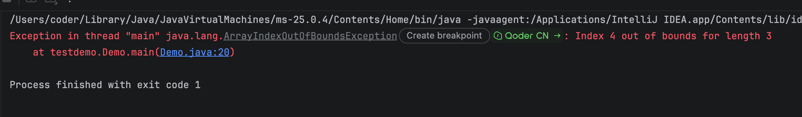

## 1. Java中的数组

Java中的数组是 **存储相同类型多个数据的容器** ，属于引用数据类型。
一旦数组创建完成， **长度固定，不可修改** 。

### 1.1 定义格式

和js不同，java中的数组使用大括号表示的 {1,2,3}，并且数组中的类型必须相同

```Java
// 格式1：静态初始化（创建数组的同时直接赋值，自动识别长度）
int[] arr = {11,22,33,44};
// 完整写法
int[] arr2 = new int[]{11,22,33,44};

// 格式2：动态初始化（只指定长度，元素自动赋默认值）
int[] arr3 = new int[5]; // 长度为5，里面初始值都是0
```

注意：不能同时既指定长度，又写大括号赋值

```JavaScript
// 错误写法
int[] arr = new int[5]{1,2,3,4,5};
```

### 1.2 数组元素的默认初始化值

动态初始化后，数组里元素会自动赋值：

- 整数类型（byte、short、int、long）：`0`
- 浮点类型（float、double）：`0.0`
- 布尔类型 boolean：`false`
- 字符类型 char：`'\u0000'`（空字符）
- 引用类型（String、自定义类）：`null`

```Java
double d = new double[2] // {0.0,0.0}
```

### 1.3 访问数组元素

1. 通过下标访问，下标从 `0` 开始
2. 获取数组长度：`数组名.length`（是属性，**没有括号**）

```Java
int[] arr = {10,20,30};
System.out.println(arr[0]); // 取第一个元素
System.out.println(arr.length); // 获取数组长度
```

下标越界：如果下标范围不在 `0 ~ length-1`，运行时抛出 `ArrayIndexOutOfBoundsException` 数组下标越界异常。



### 1.4 数组遍历

1. 普通 for 循环（可以拿到下标，适合需要操作索引的场景）

```Java
int[] arr = {10,20,30,40};
for(int i = 0; i < arr.length; i++){
    System.out.println(arr[i]);
}
```

2. 增强 for 循环（for-each，只拿元素，拿不到下标）

```Java
for(int num : arr){
    System.out.println(num);
}
```

### 1.5 数组是引用类型

数组变量存的是数组在堆内存的**地址值**，不是元素本身。

多个数组变量指向同一个地址时，修改其中一个，另一个也会跟着变化。

```Java
int[] a = {1,2,3};
int[] b = a;
b[0] = 99;
// a[0] 也变成99，二者共用同一块数组
```

### 1.6 Arrays 工具类（java.util.Arrays）

数组本身没有内置方法，大部分操作靠这个工具类，使用前需要导入包

```Java
import java.util.Arrays;

int[] arr = {3,1,5,2};
Arrays.sort(arr);                // 对数组排序（升序）
System.out.println(Arrays.toString(arr)); // 把数组转为字符串打印
int[] newArr = Arrays.copyOf(arr, 10); // 拷贝数组，第二个参数是新数组长度
boolean same = Arrays.equals(arr1,arr2); // 比较两个数组内容是否一致
```

> 重点：直接打印数组变量，输出的是内存地址，看不到里面元素，必须用 `Arrays.toString()`
