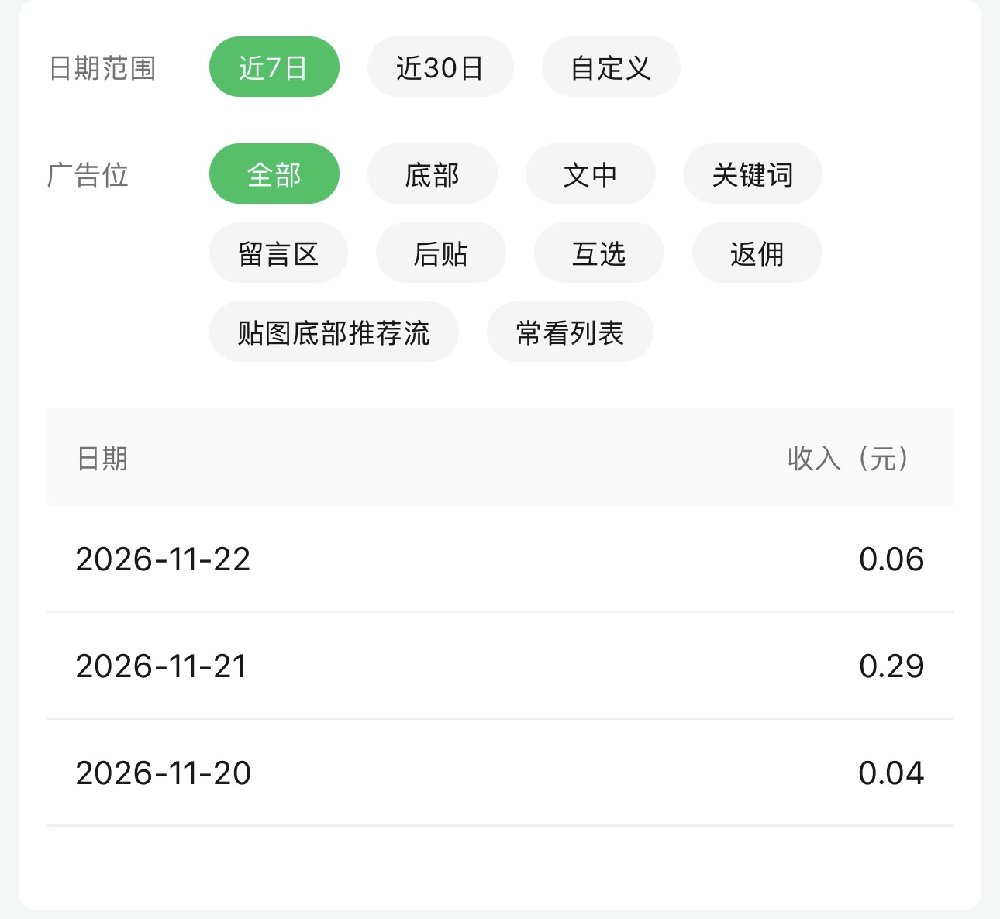

# 番外｜100 粉达成，第一笔广告收益 4 毛钱，冲 200 粉

上次那篇番外里说，攒够 100 粉就开流量主，那会儿我还一个粉丝都没到，属于先把饼画上。

今天来还愿。

粉丝破了 100，流量主开起来了，广告也挂上了。然后后台长这样——

11 月 20 号，0.04 元。21 号，0.29 元。22 号，0.06 元。

三天加起来，**四毛钱**。

笑哭。真的笑哭。

---

## 先说这四毛钱

四毛钱能干嘛？现在连一根冰棍都买不到了。

但我盯着这个截图看了好几遍，越看越乐。因为我写公众号之前，从来没想过自己会有"广告收益"这种东西。写了二十多天，从 HelloWorld 写到 Servlet 写到 Spring，发出去像丢进井里，连个回声都没有。

现在井里终于有动静了。虽然动静的价值是四毛。

说没点激动是假的。这钱少到不好意思发朋友圈，但它是真的——是有人点开、看完了、顺手碰了一下广告，才攒出来的四毛。对我来说，这比四毛钱本身值钱多了：**说明真有人在读。**

## 这 100 个粉丝，是怎么来的

其实没啥秘诀，就是厚着脸皮一篇篇发，然后去留言区一个个人打招呼。

上次番外发出去之后，我开始挨个回关、挨个回留言。慢慢发现，关注我的大多是两种人：一种也在学编程，前端转后端的、刚入行的、在计算机专业读书的；另一种是已经上岸的，过来人说句"加油"，看着就暖。

有朋友问我，才 100 粉就开流量主，广告会不会没人看、影响阅读体验。说实话我也担心过。但想了想，收益这么点，广告位就底部那么一块，真读者不会介意。而且挂不挂广告，对写东西这件事本身没影响——我照样每天写我的踩坑笔记。

## 比 100 这个数字更值钱的

写到这里，得说点真心话。

刚开始我盯着粉丝数看，从个位数到两位数，每天刷好几次后台。但真到了 100，我发现更让我高兴的不是这个数字，是能在留言区叫出好几个人的名字——谁在学 Java，谁卡在 Spring，谁也是前端转过来正在阵痛期。

100 是个门槛，过了它，流量主开了，广告挂了，四毛钱到手了。但真正留下来的，是那些聊过几句、互相鼓过劲的人。数字会涨会跌，这些人不会。

所以这次也不藏着：**冲 200 粉。**

## 冲 200 粉：还是老规矩，互关互助

玩法跟上次一样，简单直接：

- **关注我，24 小时内必回关**，一个不落；
- **每条留言都会回**，不是复制粘贴的"已关注"；
- 顺手点个「在看」、把文章读完，比单纯关注有用得多。

还是那个关键细节，重复一遍，因为真的有人踩过：**留言之前，把留言身份切换成公众号**（留言框附近能切）。公众号后台只能看到昵称头像，点不进对方的号，只有用公众号身份留言，我才能点进主页回关。不然俩人说了一晚上"已关"，谁也找不到谁。

留言的时候带一句你的号名，最好再说一句在学什么、卡在哪。这样我回关的时候能认出你，也能顺便看看有没有能搭把手的地方。

一个人闷头攒粉很慢，搭个伴就快多了。不为刷数据，就是想多认识几个同行的人。

---

四毛钱的第一笔收入，我截图存着了。等攒到 200，再回来发第二张。
